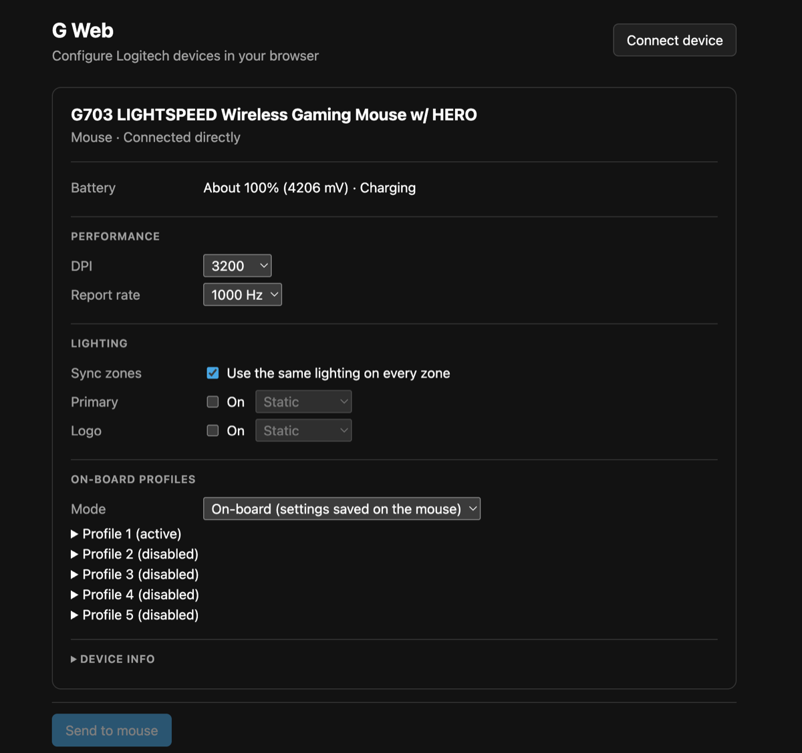

# G-Web

A Logitech™ device manager in browsers. It uses the WebHID API to talk to devices connected via USB (corded or through receivers) or Bluetooth, using Logitech's HID++ protocol. No drivers, no G HUB, no background service.

G-Web is not an official product of Logitech.

This is a fork of [yume-chan/g-web](https://github.com/yume-chan/g-web).



## What this fork adds

The upstream project can read device information, DPI, report rate and on-board profiles, but it can't touch lighting, and every dropdown writes to the device the moment you change it. This fork adds:

- **RGB lighting control** (HID++ feature `0x8071` RGB Effects, used by HERO-generation G mice such as the G703 LIGHTSPEED HERO)
  - Turn each lighting zone on or off
  - Static color, color cycle and breathing effects, with color, speed and brightness controls
  - Lighting is saved into the mouse's active on-board profile, so it survives unplugging and power cycles, just like G HUB
  - The page shows the lighting currently saved on the mouse when you connect
- **Sync zones**: one toggle to keep every lighting zone (e.g. primary and logo) the same
- **Review, then send**: changes to DPI, report rate, profile mode and lighting are collected and sent together with a single **Send to mouse** button, instead of being written on every click
- **Cleaner interface**: each device is a card with grouped sections, readable labels (report rate in Hz, effect speed in seconds, battery status in words) and diagnostics tucked under "Device info"
- **Light and dark mode** that follows your system theme
- **Library fixes and additions** in `@yume-chan/hidpp`:
  - New `RgbEffects` class for zone/effect discovery and setting effects
  - `OnBoardProfile.writeSector` / `writeProfileLeds` for writing profiles, including the CRC-16/CCITT checksum the device verifies
  - `OnBoardProfile.getCurrentProfile` read the wrong response byte, which only worked by coincidence when profile 1 was active

Tested on a G703 LIGHTSPEED HERO (USB product ID `0xC090`) connected by cable on macOS in Chrome.

## Browser support

WebHID is only available in Chromium-based desktop browsers (Chrome, Edge, Opera). Firefox and Safari are not supported.

## Limitations

1. Due to security concerns, browsers can't connect to devices automatically. You must pick the device from a browser-provided popup to grant access (once per device).
2. Because it runs in a browser, it won't support custom key mapping features that need software running in the background (divert mode), such as macros or launching programs.
3. Devices can't report their live lighting state, so the page shows what is saved in the active on-board profile. If the mouse is in host (software) mode, lighting changes apply live but aren't saved.
4. Older G mice that use the `0x8070` Color LED Effects feature (e.g. the original, non-HERO G703) aren't supported for lighting yet.

## Running locally

The repo is a [Rush](https://rushjs.io/) monorepo. Rush 5.57 and pnpm 6 require **Node.js 14 or 16** (for example `nvm use 16`).

```sh
node common/scripts/install-run-rush.js install
node common/scripts/install-run-rush.js build
cd apps/demo
node ../../common/scripts/install-run-rushx.js start
```

Then open the printed `http://localhost:...` URL in Chrome, click **Connect device** and choose your mouse (or its receiver).

## Project layout

- `libraries/hidpp`: TypeScript implementation of the HID++ protocol (`@yume-chan/hidpp`)
- `apps/demo`: the web page, built with Vite

## Roadmap

### General

- [x] Device name
- [x] Device type
- [x] Battery level
  - [x] 0x1000
  - [x] 0x1001
  - [x] 0x1004
  - [x] 0x1f20
- [x] Light and dark theme

### Receiver

- [x] List connected devices
- [ ] List paired devices
- [ ] Pair new devices

### Mouse

- [x] Report rate
- [x] DPI
- [ ] On board profile
  - [x] Basic reading
  - [x] Basic writing (lighting)
  - [ ] Button mapping
  - [x] RGB
- [ ] Button mapping
- [ ] Gesture
- [ ] **R!G!B!**
  - [x] 0x8071 RGB Effects (Off, Static, Color cycle, Breathing)
  - [x] Save lighting to the on-board profile
  - [x] Sync zones
  - [ ] 0x8070 Color LED Effects

### Keyboard

> No Logitech keyboard to test with, so no keyboard features are planned.

## References

* http://drive.google.com/folderview?id=0BxbRzx7vEV7eWmgwazJ3NUFfQ28
* [pwr-Solaar/Solaar](https://github.com/pwr-Solaar/Solaar)
* [cvuchener/hidpp](https://github.com/cvuchener/hidpp)
* [libratbag/libratbag](https://github.com/libratbag/libratbag)
* [jte/logitech-rce](https://github.com/jte/logitech-rce)
* [PixlOne/logiops](https://github.com/PixlOne/logiops)
